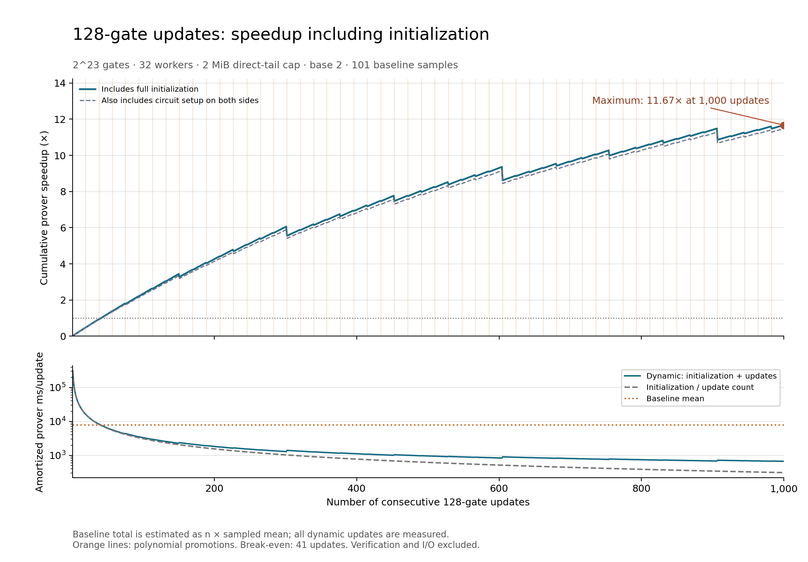

# 128-gate update amortization

The maximum over revisions 1–1,000 is **11.674× at 1,000 updates**. At 1,000 updates the speedup is **11.674×**. This is the observed maximum in this run and window, not a claim about larger update counts or a noise-free optimum.

Including circuit setup on both sides as well, the maximum is **11.478× at 1,000 updates**, and the final speedup is **11.478×**. This adds 11.659265 s to the dynamic total and 2.867369 s to the baseline total. The first setup-inclusive break-even is revision 42. The dashed curve includes these costs; the solid curve follows the existing prover-time convention.

Formula: `n * mean(sampled baseline) / (initial + sum(update[1:n]))`. The numerator uses update count times sampled baseline mean. The baseline mean is 7800.591 ms from 101 fresh proofs of this same update trajectory. With a sampled baseline, its mean is fixed across the curve, so it scales the speedup but does not determine the maximizing revision.

Initialization took 310.060889 s. Every one of the 1,000 dynamic updates was measured, including 52 polynomial promotions and their hierarchy merges. No dynamic timings are extrapolated. One full dynamic initialization is charged to the sequence; the baseline proves each updated state and is charged no extra initial-state proof, matching the preceding baseline comparison.

First break-even: **41 updates**. Speedup stays at least 1× through the end from revision **41**.

| Prefix | Baseline total (s) | Dynamic including init (s) | Amortized dynamic (ms/update) | Speedup |
| --- | ---: | ---: | ---: | ---: |
| 1 | 7.801 | 310.065 | 310064.980 | 0.025× |
| 10 | 78.006 | 310.118 | 31011.793 | 0.252× |
| 40 | 312.024 | 317.512 | 7937.798 | 0.983× |
| 100 | 780.059 | 331.918 | 3319.184 | 2.350× |
| 400 | 3120.236 | 446.123 | 1115.307 | 6.994× |
| 1,000 | 7800.591 | 668.214 | 668.214 | 11.674× |

Circuit: 2^23 = 8,388,608 gates, half addition and half multiplication, identity wiring, 256 public inputs, seed 20260909. Each revision selects 128 distinct gates uniformly without replacement and supplies the complete three-wire tuple of every selected gate. A gate can recur in later revisions. Full ordinary HyperPlonk and the dynamic system both use the existing native GF(2^128) / Ligerito Fast configuration.

The run used 32 workers, a 2048 KiB direct-tail cap, and a base-2 hierarchy with up to 1 tables per size level, and baseline cadence 10 (also including both endpoints). Sampled-pair execution order alternates. Timers include witness construction and hierarchy work; setup/indexing, verification, serialization, statistics, workload generation and I/O are outside the prover timers. `setup.json` records indexing costs separately; the setup-inclusive curve adds these measured costs once on each side. All timings are retained; there are no discarded warmups.

All 1,102 measured proofs verified. The existing runner also serializes, decodes and reverifies initialization, baseline snapshots, polynomial promotions, and first/final dynamic proofs. `curve.csv` contains all integer prefixes; `summary.json` contains the exact maximum, promotion revisions, memory measurements and run metadata. `run-a/` retains raw evidence.
